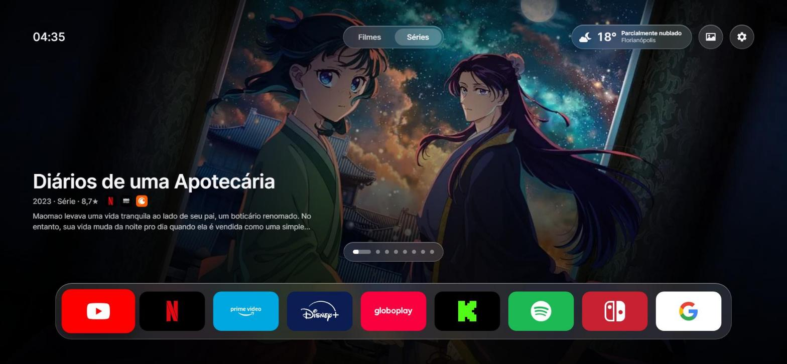

<div align="center">

# Zen

**Uma home zen para TVs LG webOS. Sem anúncios, sem bagunça.**



</div>

Zen é um fork do [**Free My TV for LG webOS**](https://github.com/danielthejoker18/FreeMyTvWebOS), de [danielthejoker18](https://github.com/danielthejoker18). A base continua a mesma: um app web leve, instalado na TV pelo Developer Mode, sem root e sem anúncios, que abre os apps instalados pelo barramento Luna do webOS. Por cima dessa base, o Zen refaz a interface no estilo da Apple TV, totalmente em português.

## O que o Zen muda

**Visual no estilo tvOS**
- Banner em tela cheia com os filmes e séries em alta, em carrossel. A barra do ponto ativo enche com o tempo, pausa quando o banner está em foco e as setas ← → trocam o título.
- Botões, abas, clima e popups em Liquid Glass: vidro translúcido com desfoque e brilho na borda.
- Dock de apps centralizado sobre vidro, com ícones 5:3 e logos atualizados: Prime Video, Globoplay, Twitch, Kick e Google para o navegador.
- Tipografia Inter embutida no app (funciona offline) e escala de 4 tamanhos de fonte.
- Animações leves, só em CSS: popups e a troca para os widgets são instantâneos, para rodar liso no hardware da TV.

**Filmes e séries**
- Em alta da semana direto do TMDB, em português (título, sinopse, ano e nota).
- Logos dos streamings onde cada título está disponível no Brasil, ao lado da nota (dados do JustWatch).
- O OK no banner abre o app do streaming certo, dando preferência a um que já esteja no seu dock.

**Widgets**
- A seta ↓ a partir do dock (ou a rodinha do Magic Remote) abre uma segunda tela de widgets, e Voltar retorna.
- Imagem do dia do Wikimedia Commons, que também vira o fundo da tela.
- Próximo lançamento de foguete com contagem regressiva ao vivo (Launch Library 2).
- Dólar, euro e bitcoin com a variação do dia (AwesomeAPI).
- Notícias de tecnologia do TabNews e do Hacker News. As matérias do TabNews abrem inteiras dentro do Zen, e ↑ ↓ rolam o texto. As do Hacker News abrem no navegador da TV.
- Jogos grátis agora na Epic, Steam, GOG, PS5 e Xbox (GamerPower).
- O OK abre os detalhes. Nada precisa de chave, e um cache local respeita os limites das APIs e mantém os últimos dados quando a rede cai.

**Entradas HDMI**
- Escolha o videogame de cada entrada (PlayStation 5 e 4, Xbox, Nintendo Switch, PC Gamer). O ícone passa a mostrar o logo do aparelho.

**Clima**
- Widget com temperatura, condição e cidade, em português.
- Popup no estilo do app Tempo da Apple, com próximas horas e nascer e pôr do sol.
- Ícones do Font Awesome, com versões noturnas (lua) depois do pôr do sol.

**Ajustes**
- Painel dividido, como nos Ajustes do Mac e da Apple TV: categorias à esquerda e opções à direita, navegável pelo controle em duas colunas.
- Escolha até 9 apps para o dock e reordene direto na tela inicial.

**Proteção de tela com quadros de arte**
- 16 pinturas famosas em domínio público do The Metropolitan Museum of Art (Hokusai, Van Gogh, Bruegel, Bierstadt, Turner, Seurat e outros), em tela cheia, com transição suave e legenda de museu.
- Escolha as obras favoritas, o tempo para começar ou o estilo relógio.
- Botão de modo arte na tela inicial para abrir os quadros na hora.

## Instalação

Você precisa de uma TV LG com webOS 3.0 ou mais novo e de um computador na mesma rede, só para a instalação.

**1. Ative o Developer Mode na TV**
1. Na LG Content Store, instale o app **Developer Mode**.
2. Entre com uma conta gratuita de [desenvolvedor LG](https://webostv.developer.lge.com) e ligue o **Dev Mode Status**. A TV reinicia.
3. Abra o Developer Mode de novo, ligue o **Key Server** e anote o IP e a senha que aparecem na tela.

> A sessão do Developer Mode expira depois de algumas centenas de horas. Renove no app, senão o Zen some da TV.

**2. Configure a chave do TMDB (opcional, mas recomendado)**

Sem chave, o banner mostra uma lista de filmes fixa. Com ela, mostra o que está em alta de verdade. A chave é grátis em [themoviedb.org/settings/api](https://www.themoviedb.org/settings/api).

```bash
git clone https://github.com/henriquemtn/zen.git
cd zen
cp .env.example .env    # coloque sua chave em TMDB_API_KEY
```

A chave vai para o pacote `.ipk` instalado na TV, não para o repositório: `.env`, `app/env.js` e `dist/` estão no `.gitignore`. Você também pode colar a chave depois, na TV, em Ajustes → Filmes e séries.

**3. Instale**

Com Python e Node.js instalados:

```bash
python scripts/install.py
```

O instalador acha a TV na rede, pareia a chave SSH, gera o `.ipk` e instala.

Outra opção é rodar `python scripts/build.py` e instalar o `.ipk` de `dist/` pelo [webOS Dev Manager](https://github.com/webosbrew/dev-manager-desktop/releases).

> **Dica:** dentro do Zen, segure o número **1** no controle e associe o app à tecla. Depois é só segurar **1** de qualquer lugar da TV para abrir o Zen.

## Desenvolvimento

O app é HTML, CSS e JavaScript puro, sem build. Para ver no navegador:

```bash
node scripts/env.js                 # gera app/env.js a partir do .env
npx http-server app -p 8080 -c-1    # abra http://localhost:8080 em 1920x1080
```

No navegador tudo funciona, menos abrir apps e trocar de HDMI, que dependem da TV. As setas do teclado fazem o papel do controle.

```
app/
├── index.html        # toda a interface: estilos, layout e lógica
├── appinfo.json      # manifesto do app webOS
├── assets/
│   ├── art/          # quadros do protetor de tela (+ SOURCES.md)
│   ├── brands/       # logos dos apps e consoles (+ SOURCES.md)
│   └── fonts/        # Inter
scripts/
├── build.py          # gera o .ipk (roda env.js antes)
├── env.js            # .env → app/env.js
└── install.py        # descobre a TV e instala
DESIGN.md             # referência visual usada no redesign
```

## Créditos

- Projeto original: [Free My TV for LG webOS](https://github.com/danielthejoker18/FreeMyTvWebOS), por danielthejoker18, que por sua vez se inspirou no [free-my-tv](https://github.com/simbasjungles/free-my-tv) para Google TV.
- Filmes e séries: [TMDB](https://www.themoviedb.org). Onde assistir: [JustWatch](https://www.justwatch.com). Este produto usa a API do TMDB, mas não é endossado nem certificado pelo TMDB.
- Clima: [Open-Meteo](https://open-meteo.com).
- Quadros: [The Metropolitan Museum of Art](https://www.metmuseum.org/about-the-met/policies-and-documents/open-access), Open Access (CC0). Lista completa em `app/assets/art/SOURCES.md`.
- Ícones de clima: [Font Awesome Free](https://fontawesome.com/license/free) (CC BY 4.0). Logos: [Simple Icons](https://simpleicons.org) (CC0) e Wikimedia Commons, com detalhes em `app/assets/brands/SOURCES.md`. As marcas pertencem aos seus donos.
- Fonte: [Inter](https://rsms.me/inter/) (SIL OFL).

## Licença

[MIT](LICENSE), a mesma do projeto original.
